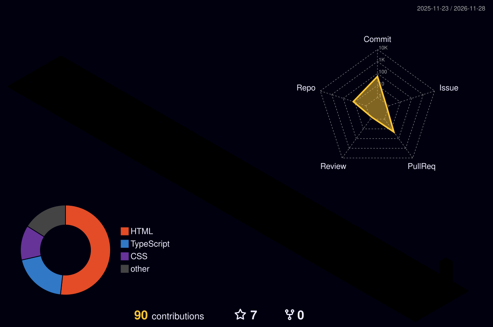

  <!-- Animated Typing Header -->
  

  <!-- 3D Isometric Contribution Graph -->
  

### 🚀 About Me
- 🔭 Currently working on **AI/ML, Agentic AI & Full-Stack Web Projects**
- 💻 Practicing **DSA in Java & Python** (LeetCode & Codeforces)
- 🏆 Building solutions for **Hackathons & Ideathons**

### 🛠️ Tech Stack

  

### 📊 GitHub Stats

  
  

